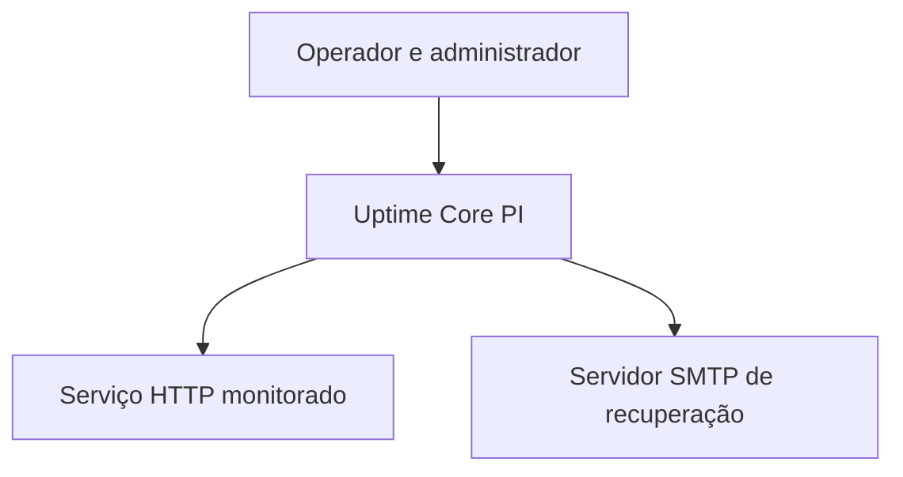
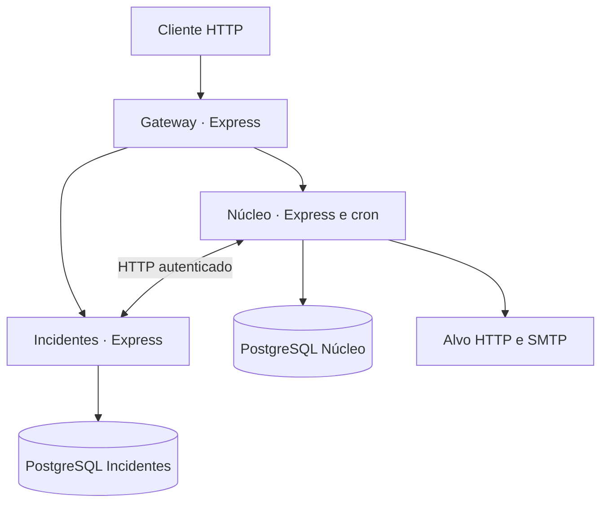
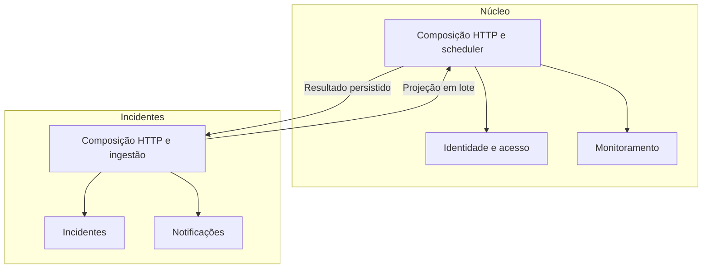
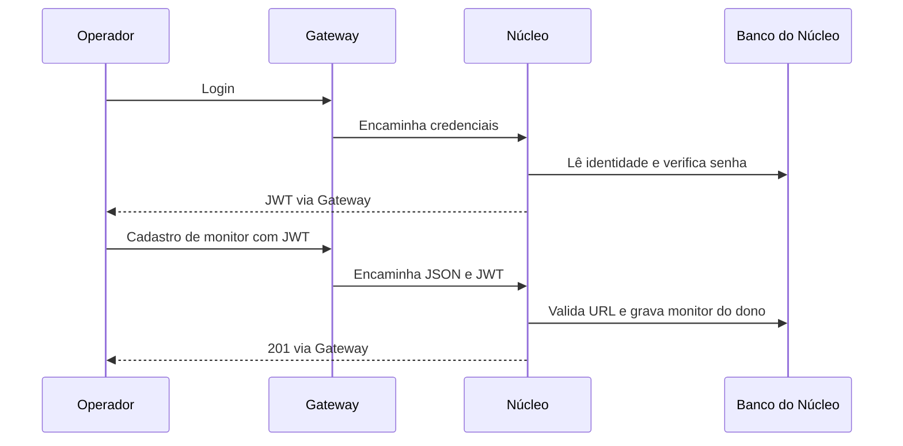
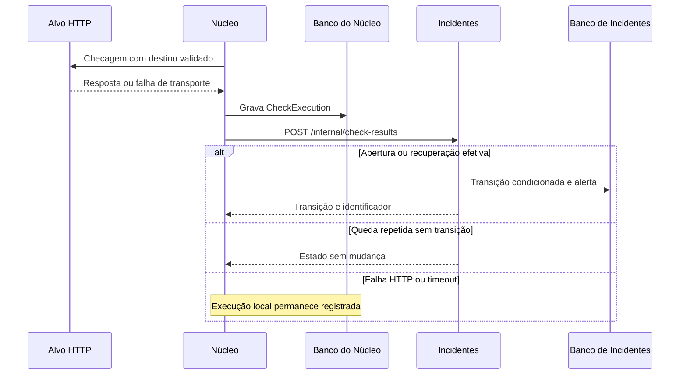
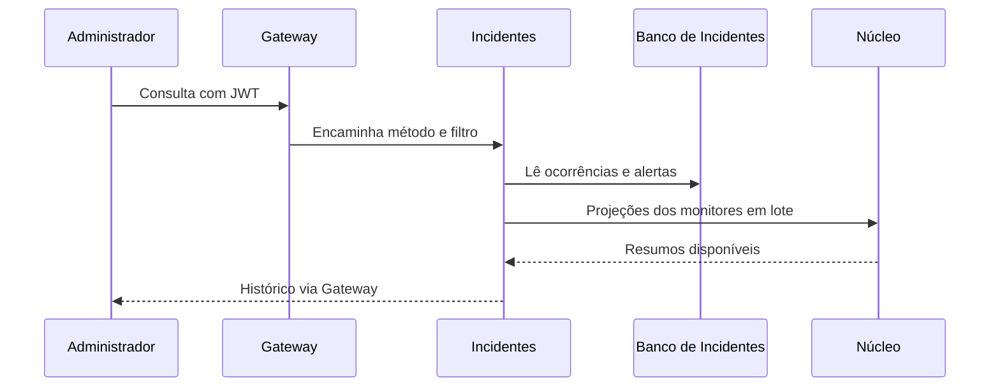

# Arquitetura do D3

O Uptime Core PI atende operadores que cadastram serviços HTTP e administradores que investigam indisponibilidades. O [ADR 0002](adr/0002-decomposicao-d3.md) registra a decomposição e o [ADR 0003](adr/0003-garantias-do-monitoramento.md) registra as proteções de domínio.

## C4 · Contexto e contêineres

## C4 · Componentes e mapa de contextos

| Contexto | Serviço e dados | Fronteira |
|---|---|---|
| Identidade e acesso | Núcleo, `User` | Usuários, JWT, autorização e recuperação via SMTP |
| Monitoramento | Núcleo, `Monitor` e `CheckExecution` | Cadastro, política de destinos, scheduler, execução e consulta local |
| Incidentes | Incidentes, `Incident` | Ingestão autenticada, transições automáticas, operações administrativas e histórico |
| Notificações | Incidentes, `Alert` | Registro de alerta simulado e consulta por monitor ou incidente |

O Núcleo preserva as cascatas entre usuários, monitores e execuções. Incidentes preserva a FK de alertas para incidentes dentro do próprio PostgreSQL, com `SET NULL` na exclusão. `monitorId` é uma referência externa, sem FK. Ao excluir o cadastro, o Núcleo remove suas execuções e a outra unidade mantém o histórico operacional. Respostas enriquecidas usam `monitor: null` para registros cujo cadastro deixou de existir. Consultas combinadas deduplicam IDs e consultam o Núcleo em lotes de 500. O Gateway só encaminha, sem cliente Prisma.

O guard verifica imports estáticos, ciclos por proibição de imports entre contextos, acesso à persistência, reexports e imports entre unidades. O ponto de configuração Prisma de cada serviço é o único consumidor do cliente gerado daquele serviço. A configuração do banco não é um contrato público. A checagem estática cobre JavaScript em produção e mantém imports dinâmicos e comportamento em runtime fora de seu alcance.

## Sequências HTTP

## Contratos, segurança e consistência

O [OpenAPI do Núcleo](../services/core/openapi/openapi.json) e o [de Incidentes](../services/incidents/openapi/openapi.json) são a fonte dos contratos. As rotas internas usam uma credencial dedicada e ficam fora do Gateway. Cada serviço valida JWT e roles localmente. As credenciais entre serviços não são encaminhadas pelo Gateway. Os clientes internos têm três segundos por operação, e o Gateway tem oito segundos. O [guia operacional](operations.md) descreve os códigos de falha.

Bloqueio de URL, destino de DNS ou redirecionamento não é queda do serviço monitorado. A política usa a resolução efetiva da conexão com validação de todos os endereços, agentes diretos e TLS padrão. Limites, exceção de teste e riscos residuais estão no ADR 0003. O armazenamento de senha segue com bcrypt, e o digest de recuperação é invalidado na mesma instrução que grava a senha nova.

O PostgreSQL impede dois incidentes abertos do mesmo monitor. Apenas abertura ou recuperação vencedora pede alerta. Uma execução sem entrega ao serviço de Incidentes permanece no Núcleo. Nenhum retry automático reordena resultados. Um resultado antigo entregue depois da recuperação ainda pode abrir outro incidente. A gravação de alertas é independente da transição. Veja [Serviços e comunicação](services.md).

## Matriz de conformidade

| Critério | Evidência |
|---|---|
| Dois serviços e dois bancos | Workspaces, processos e Dockerfiles separados, invariantes e migrations próprias |
| Contratos OpenAPI | JSON versionado por serviço, validação sintática e estrutural e comparação de rotas na CI |
| Gateway | Encaminhamento HTTP, respostas de indisponibilidade e proteção das rotas internas |
| Docker Compose | Cinco unidades, redes separadas, health checks e smoke previstos no workflow |
| Contextos e fluxo ponta a ponta | Quatro módulos e suíte com PostgreSQL duplo, Gateway, HTTP interno e alvo controlado |
| Decisões e CI | ADRs 0000 e 0001 históricos, ADRs 0002 e 0003 atuais e job de validação |

A referência do D2 integrado tinha 59 testes de integração e 7 do guard. O workflow do D3 valida testes individuais, concorrência, dependências, contratos e execução dos contêineres. Consulte o resultado no commit avaliado.

## Continuidade

- D4: o produtor natural é Monitoramento, com evento de checagem concluída vinculado ao ID da execução. A transação local pode passar a gravar execução e Outbox juntas.
- D5: ativação de monitor com política de notificação continua candidata se houver etapas e compensações legítimas.
- D6: respostas administrativas enriquecidas são candidatas a projeções de leitura.
- D7: as chamadas do Gateway e dos clientes internos são pontos naturais de observabilidade e resiliência.
- D8: os builds já são separáveis. O ambiente alvo ainda precisa de TLS, segredos gerenciados, saída de rede controlada e estratégia de migração.
