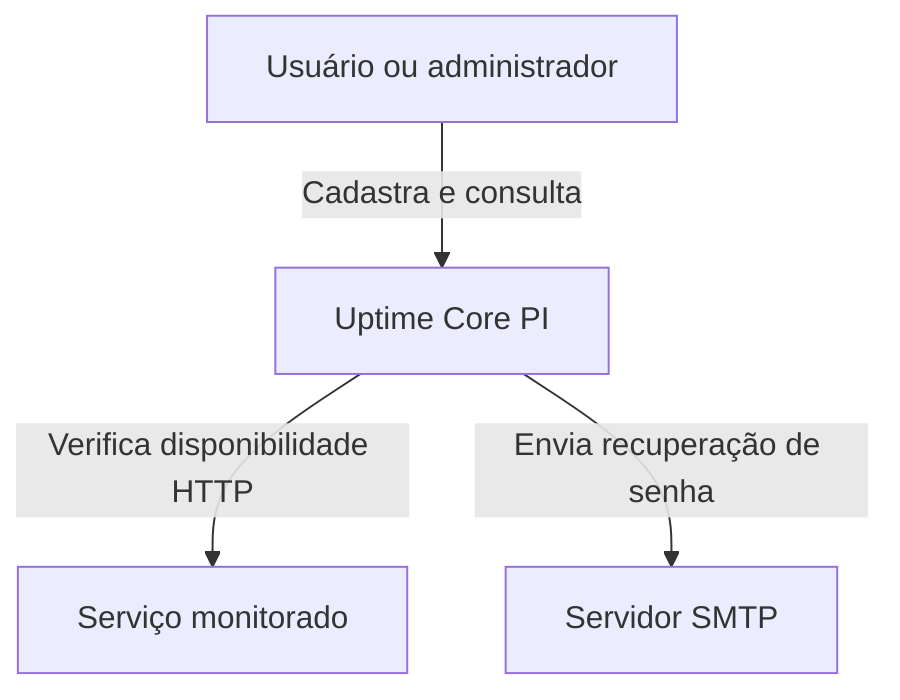
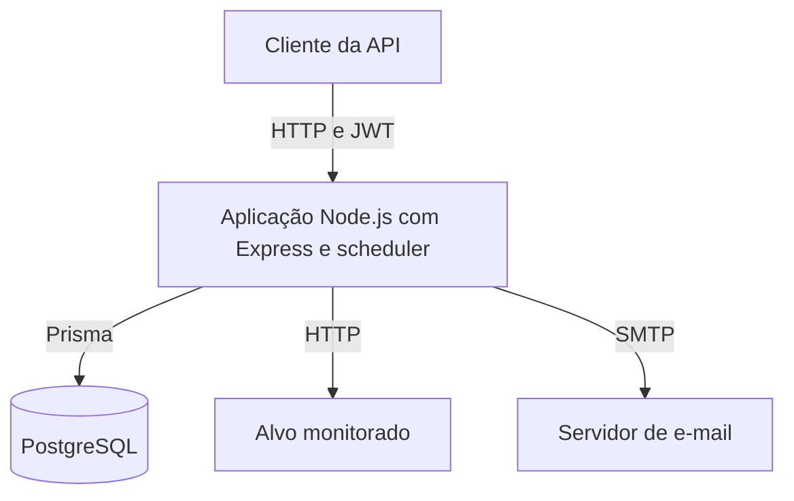
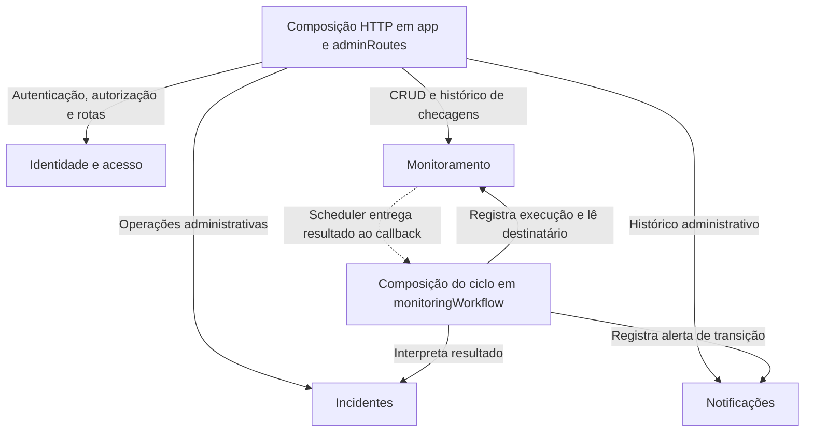

# Arquitetura do Uptime Core PI

O Uptime Core PI roda em um único processo Node.js com Express, scheduler e Prisma. O PostgreSQL continua compartilhado fisicamente. O D2 organiza o código em contextos que expõem operações públicas e controlam os próprios acessos de escrita.

## C4 · Contexto do sistema

## C4 · Contêineres

O banco de testes do Compose serve à suíte. A aplicação usa um banco de execução.

## C4 · Componentes e mapa de contextos

As setas contínuas mostram as chamadas feitas pela composição. A seta pontilhada é a invocação do callback configurado na inicialização. Os contextos ficam em `src/modules/`. Os imports entre eles são proibidos, inclusive para pontos públicos. A composição acessa apenas os `index.js`. Os quatro módulos são componentes internos da aplicação.

| Contexto | Responsabilidade e dados próprios | Contratos públicos e consumidores |
|---|---|---|
| [Identidade e acesso](../src/modules/identity/index.js) | Cria, consulta, atualiza e exclui `User`. Gerencia credenciais, sessão, recuperação via SMTP e autorização administrativa | `authRoutes`, `userRoutes`, `authenticate`, `requireAdmin` e `countUsers()` para composição HTTP |
| [Monitoramento](../src/modules/monitoring/index.js) | Controla `Monitor` e `CheckExecution`, cadastro, agenda, requisição HTTP e registro da execução | Rotas de monitores e de execuções, `countMonitors()`, `scheduler`, `saveExecution(monitorId, result)` e `findAlertRecipient(monitorId)` |
| [Incidentes](../src/modules/incidents/index.js) | Cria, resolve, reabre, consulta e exclui `Incident`. Aplica transições automáticas a partir do resultado da checagem | Rotas administrativas e `incidentService.handleStatus(monitorId, result)`, que informa a transição e o incidente |
| [Notificações](../src/modules/notifications/index.js) | Cria, consulta e exclui `Alert`. Decide o conteúdo conforme a transição recebida e registra o alerta simulado | Rotas administrativas e `alertService.sendMockEmail(monitorId, incidentId, status, reason, findRecipient)`. A composição fornece a função de leitura do destinatário |

### Propriedade e exceções de leitura

Cada `persistence.js` disponibiliza ao respectivo módulo somente os delegates Prisma dos modelos da tabela acima. Os handlers HTTP chamam suas operações de persistência locais. Os testes de integração usam o cliente compartilhado para montar e verificar fixtures.

As consultas administrativas preservam os relacionamentos projetados pelo contrato HTTP. Incidentes lê monitores e alertas pelo Prisma. Notificações lê monitores e incidentes. Monitoramento lê nome e e-mail do dono para detalhar um monitor e preparar o destinatário de um alerta. A leitura do destinatário permanece em uma consulta relacional. O módulo de Notificações recebe essa capacidade por parâmetro. A recuperação de acesso continua em Identidade e é o único fluxo que usa SMTP.

As chaves estrangeiras e o comportamento de cascata permanecem no schema. A exclusão de usuário ou monitor pode remover registros descendentes, e a exclusão de incidente zera a referência nos alertas quando aplicável. São efeitos do banco já previstos no [schema Prisma](../prisma/schema.prisma). Na extração será necessário decidir a retenção do histórico e substituir joins e cascatas entre serviços.

## Comunicação e proteção de fronteiras

[monitoringWorkflow.js](../src/monitoringWorkflow.js) coordena chamadas síncronas aguardadas no mesmo processo. Monitoramento grava uma execução, Incidentes determina a transição e Notificações registra alerta quando o estado muda. As escritas continuam em operações separadas. Falha ao persistir uma execução interrompe o processamento do resultado. Falha no alerta deixa a transição de incidente registrada.

`npm run test:architecture` analisa imports e reexports estáticos com o parser Acorn em `scripts/architecture/check.mjs`. A configuração do banco é o único arquivo de produção autorizado a importar os pacotes de cliente e adaptador do Prisma. Apenas os módulos de persistência podem importar o cliente compartilhado. Os pontos públicos declaram exports nomeados e o guard rejeita reexports com `*`, inclusive namespaces. A integração passa pelos três arquivos de composição declarados. A regra impede ciclos estáticos entre contextos. Os sete testes do guard incluem imports privados, dependências em ambas as direções, imports do Prisma e reexports irrestritos. A CI executa o comando no mesmo job do lint e da integração.

O analisador cobre ESM estático em `src/**/*.js`. Imports dinâmicos, chamadas em runtime, módulos fora de `src` e acesso relacional dentro de delegates Prisma ficam fora da inspeção. Preserve a propriedade dos dados ao revisar alterações de persistência.

## Continuidade para o D3

| Candidato | Contratos e dependências | Risco e esforço |
|---|---|---|
| Núcleo de Monitoramento + Identidade | Mantém usuários, credenciais, monitores, execuções, checagens HTTP e SMTP de recuperação. Pode fornecer leitura da configuração do monitor e publicar resultados em etapa futura | Políticas de exclusão e identificação de usuários no gateway precisam ser decididas. Média |
| Incidentes | Recebe resultado da checagem, resolve transições e expõe histórico. Candidato para produzir mudança de estado e fornecer consultas autenticadas | Separar FK de monitor, alertas incluídos nas respostas e semântica da resolução manual. Média a alta |
| Notificações | Recebe transição confirmada, localiza destinatário por contrato e persiste o alerta. Pode ser extraído separadamente conforme o escopo do D3 | Separar relações com monitor e incidente, definir identidade de destinatário e demonstrar entrega durável em desafio posterior. Alta |

O recorte inicial sugerido para dois serviços é **Núcleo** e **Incidentes**, com Notificações dentro do segundo serviço até a equipe avaliar uma extração própria. Antes de separar, decidir como preservar os joins da API, as exclusões e a ordem de processamento. A [visão do produto](visao-produto.md) registra a hipótese de transação compensável para discussão antes do D5.

## Evidências e critérios do D2

| Critério | Evidência | Situação |
|---|---|---|
| Monólito modular e pelo menos três contextos | Quatro pontos públicos, persistência com acesso por proprietário e composição no mesmo processo | Implementado e verificado por inspeção e guard |
| Um fluxo funcional ponta a ponta | [Teste do ciclo](../tests/integration/monitoringWorkflow.test.js) com PostgreSQL, Express, scheduler e alvo HTTP local | Aprovado na CI com PostgreSQL 15 |
| Aplicação demonstrável | [Roteiro da vitrine](vitrine-d2.md), configuração do Compose aceita e migrations SQL verificadas | Inicialização do servidor e scheduler, health e Swagger aprovados na CI. Ensaio da apresentação pendente |
| Diagrama, domínio e decisões | [Domínio](dominio.md), diagramas acima e [ADR 0001](adr/0001-monolito-modular.md) | Documentado |
| Processo de entrega | [CI](../.github/workflows/ci.yml) com guard e suíte do D1 preservada | CI do D2 aprovada |

A baseline é o [D1 integrado na main](https://github.com/danieLx77/uptime-core-PI/commit/0b9f25b4202c59cc7578520d993321287a7bcf6d). A [CI do conteúdo equivalente do PR #2](https://github.com/danieLx77/uptime-core-PI/actions/runs/45288425997) registrou 58 testes aprovados, 11 suítes e cobertura de 85,51% de linhas e 60% de branches. A [CI anterior à revisão técnica do D2](https://github.com/danieLx77/uptime-core-PI/actions/runs/45291892962) registrou 59 testes aprovados em 12 suítes, além de 5 verificações de arquitetura. Nessa execução, a cobertura foi de 86,08% de linhas, 67,58% de branches e 90,47% de funções. Na baseline, a cobertura de funções foi de 93,75%. O parser do Compose passou localmente. O daemon Docker estava indisponível para executar a composição completa. Configurações administrativas de GitHub Projects, branch protection e SonarCloud requerem confirmação externa.

## Leitura complementar

- [Serviços e fluxo executado](services.md)
- [Domínio, glossário e Event Storming](dominio.md)
- [Roteiro da vitrine](vitrine-d2.md)
- [ADR 0001 — Monólito modular](adr/0001-monolito-modular.md)
