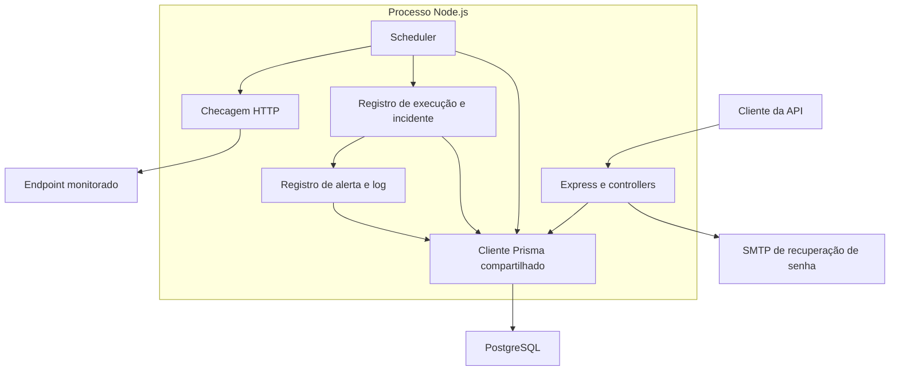
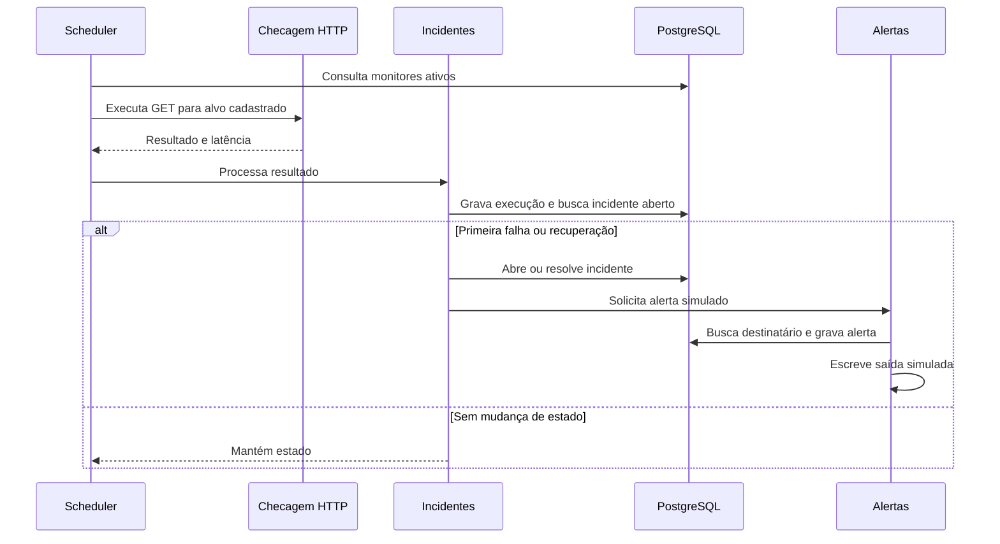

# 02 · Diagnóstico técnico

## Produto e arquitetura atual

O produto atende equipes de desenvolvimento, DevOps e administração de sistemas que precisam detectar indisponibilidade e consultar o histórico operacional. O projeto entrega uma API, sem frontend próprio neste snapshot. O stack combina Node.js 24, módulos JavaScript ES, Express 5, Prisma 7 com adaptador `@prisma/adapter-pg`, PostgreSQL 15 no Compose, Axios, node-cron, JWT, bcryptjs e Nodemailer. O npm usa lockfile para resolução de dependências. Swagger, Insomnia, ESLint, Prettier, Jest e Supertest apoiam documentação e desenvolvimento.

O estilo observado é **monólito em camadas técnicas com scheduler embutido**. [src/server.js](../../src/server.js#L6) inicia Express e agendamento no mesmo processo. [src/app.js](../../src/app.js#L76) monta rotas de autenticação, usuários, monitores e administração. Controllers e serviços dependem diretamente do mesmo cliente Prisma, e o scheduler invoca checagem e incidentes em memória. Checagem, incidente e alerta têm responsabilidades identificáveis, mas ainda compartilham persistência e chamadas entre classes. A organização atual dá pontos de extração. A encapsulação de domínio, a propriedade de dados e a implantação independente ainda precisam ser construídas.

## Fluxos e regras

| Fluxo | Implementação e evidência |
|---|---|
| Cadastro e login | [UserController.create](../../src/controllers/UserController.js#L5) valida dados, aplica bcrypt e retorna campos selecionados. [SessionController.create](../../src/controllers/SessionController.js#L6) valida a senha e assina JWT com expiração configurável |
| Sessão, perfil e administração | [auth.js](../../src/middlewares/auth.js#L16) verifica o JWT e injeta usuário e role. [isAdmin.js](../../src/middlewares/isAdmin.js#L3) restringe rotas administrativas. `UserController` implementa listagem administrativa, leitura, edição e exclusão conforme as rotas e verificações de propriedade |
| Recuperação de senha | [PasswordController.forgotPassword](../../src/controllers/PasswordController.js#L8) persiste token com vencimento e chama SMTP. [resetPassword](../../src/controllers/PasswordController.js#L59) confere token/validade, atualiza o hash e limpa os campos de recuperação |
| Cadastro e ciclo de monitor | [MonitorController](../../src/controllers/MonitorController.js) cria, lista, detalha, atualiza e exclui monitores. Listagem filtra pelo dono. Leitura, edição e exclusão por ID verificam dono ou admin. O monitor nasce ativo, com intervalo padrão de cinco minutos, e pode ser pausado |
| Checagem HTTP | [SchedulerService.start](../../src/services/SchedulerService.js#L7) consulta monitores ativos por minuto, escolhe pelo módulo do minuto atual e os processa sequencialmente. [PingService.execute](../../src/services/PingService.js#L8) usa Axios GET com limite de dez segundos e devolve sucesso, status, latência e motivo |
| Incidentes e alertas | [IncidentService.handleStatus](../../src/services/IncidentService.js#L5) grava a execução e busca incidente aberto. Uma falha abre incidente se nenhum estiver aberto. Uma recuperação fecha o aberto. Nas transições, [AlertService.sendMockEmail](../../src/services/AlertService.js#L7) lê monitor e usuário, registra `Alert` e simula a saída no terminal. O SMTP é usado pelo fluxo de senha |
| Operação administrativa | [adminRoutes.js](../../src/routes/adminRoutes.js) conta usuários e monitores e expõe consultas sobre incidentes, alertas e execuções. Os controllers têm filtros e joins Prisma. Incidentes podem ser resolvidos e reabertos manualmente; alertas e execuções têm exclusão administrativa |

## Persistência e consistência

| Modelo | Relações e integridade | Propriedade candidata |
|---|---|---|
| `User` | E-mail único. Hash e token de recuperação. A exclusão propaga aos monitores | Identidade |
| `Monitor` | FK para usuário. Estados `ACTIVE` e `PAUSED`; exclusão propaga a execuções, incidentes e alertas | Monitoramento |
| `CheckExecution` | FK para monitor, código HTTP anulável, latência e timestamp. Índice `monitorId,timestamp` | Monitoramento |
| `Incident` | FK para monitor, status `OPEN` ou `RESOLVED`, motivo e timestamps. A consulta de incidente aberto é feita por regra na aplicação | Incidentes |
| `Alert` | FK obrigatória para monitor e opcional para incidente; `SetNull` ao excluir incidente. `sentAt` é preenchido no registro simulado | Notificações |

O [schema](../../prisma/schema.prisma#L36) e a [migration inicial](../../prisma/migrations/20260422034641_init/migration.sql) sustentam as relações. As outras três migrations acrescentam campos de redefinição de senha, motivo do incidente e nome do monitor. Controllers e serviços acessam o Prisma diretamente, sem repositórios de domínio. As etapas de execução, incidente e alerta são escritas separadamente. A busca seguida de criação de incidente aberto não é protegida por unicidade no schema. Com concorrência, existe risco de duplicação. A exclusão em cascata e os joins administrativos exigem decisões explícitas de retenção e integração antes de separar os bancos.

## Mensageria e processamento

O agendamento em background usa node-cron. Na execução, as chamadas entre serviços são diretas e aguardadas. A tabela `Alert` guarda a notificação simulada, sem estado de entrega, relay ou vínculo transacional com a mudança de incidente. A leitura de um incidente aberto evita gerar novo alerta em checagens sucessivas no caso sequencial. Esse comportamento não deduplica entregas concorrentes e não implementa consumo idempotente.

As dependências, o schema, o Compose e a implementação dos serviços não apresentam broker, publicação/consumo de eventos, outbox/inbox, confirmação de entrega, fila de falhas ou compensação. `IncidentService` e `AlertService` registram erros e encerram o processamento, o que pode preservar um incidente com alerta ausente. Uma recuperação do alvo resolve o incidente por mudança real de estado do monitor. Fluxos administrativos de resolver/reabrir atualizam o banco diretamente em [AdminIncidentController](../../src/controllers/AdminIncidentController.js#L90).

## Qualidade, infraestrutura e observabilidade

| Aspecto | Evidências e limites |
|---|---|
| Testes | `tests/integration/` tem 11 arquivos e 58 declarações de caso `it` ou `test`. Jest usa Supertest e, para casos com persistência, PostgreSQL. O teste de incidentes aciona o serviço com resultados de checagem sintéticos. A suíte de senha simula `sendMail`. A suíte HTTP de apresentação/health não depende do scheduler. Não foi identificada suíte unitária dedicada, E2E de processos independentes ou teste de contrato. Cobertura configurada com V8 e execução pendente |
| Build e análise | `package-lock.json`, Dockerfile Node 24, `eslint.config.js`, `.prettierrc`, `.husky/pre-commit` e `jest.config.js`. O caminho de build da imagem inclui geração de Prisma Client e Swagger. A CI acadêmica configura geração, lint, migrations e testes. A primeira execução remota do workflow atual está pendente. A configuração de Sonar e de deploy da origem foi excluída |
| Contêineres | `docker-compose.yml` sobe API, Postgres de aplicação e Postgres de testes. O banco de teste tem volume distinto e não representa outro serviço de negócio. Nomes/portas são fixos. O Compose validou sintaticamente |
| Operação | Health da API retorna status/timestamp, sem consultar DB ou worker, em [src/app.js](../../src/app.js#L55). O health do Postgres no Compose usa `pg_isready`. Endpoint administrativo de contagens consulta tabelas diretamente. Console tem logs de inicialização, checagem, transição e erro. Não há métricas instrumentadas, correlação, tracing ou exportador |
| Resiliência | Timeout de dez segundos implementado no GET para o alvo. Tratamento por monitor no scheduler reduz efeito de uma falha sobre os seguintes. O processamento sequencial e o cálculo pelo minuto da hora podem atrasar ou repetir trabalho de forma irregular, especialmente com múltiplas réplicas e intervalos incompatíveis com o relógio. Sem política de retry/backoff, circuit breaker ou coordenação de execução |
| Segurança e segredos | JWT, bcrypt, controle de acesso, CORS configurável e tratamento de erros. A validação de URL em `MonitorController` é sintática e o scheduler realiza a requisição do lado servidor. Antes de expor a API, defina política de destinos e controle de saída para mitigação de SSRF. A recuperação guarda token em claro no banco e o alerta simulado registra destinatário e mensagem no console. O Compose contém valores locais demonstrativos e o Dockerfile usa `COPY . .` e o `.dockerignore` do D1 exclui arquivos de ambiente e saídas locais do contexto de build |

A classificação acima vem de inspeção do código e das configurações. [01 · Importação](01-importacao.md#validações) registra separadamente os resultados que foram executados.
