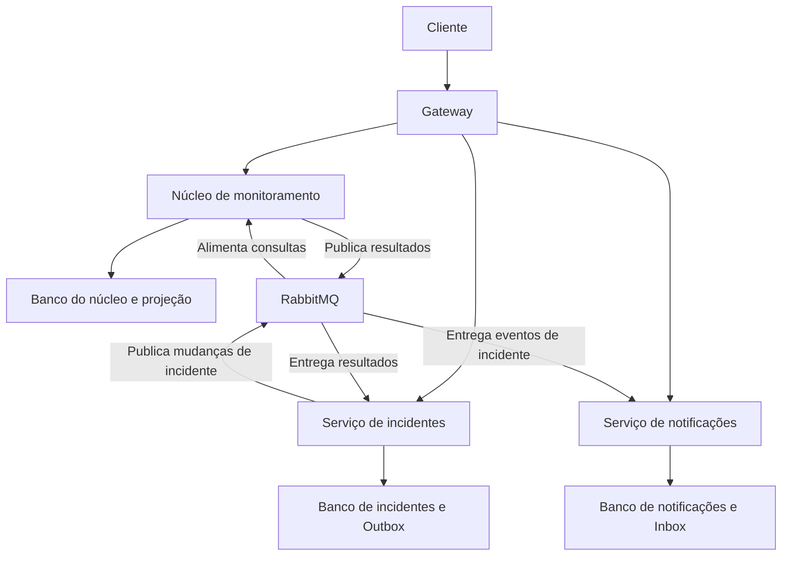

# 05 · Plano preliminar de adaptação

## Arquitetura candidata

Manter Node.js, Express, Prisma, PostgreSQL e npm. Modularizar primeiro dentro de um único processo. Separar os contextos por casos de uso e acesso aos dados antes de criar processos adicionais. Preservar os endpoints atuais no gateway enquanto os dados operacionais migram para seus donos.

| Contexto | Estado e regras de domínio | Destino candidato |
|---|---|---|
| Identidade | Cadastro, perfil, credenciais, recuperação, papéis | Contexto de suporte que permanece no núcleo |
| Monitoramento | Definição do alvo, ciclo do monitor, agenda e execuções | Núcleo HTTP e scheduler inicialmente. Coordena a ativação candidata |
| Incidentes | Abertura, supressão de duplicidade, recuperação e ajustes administrativos | Primeiro serviço extraído. Banco de incidentes e outbox próprios |
| Notificações | Política de aviso, destinatário, histórico e estado de entrega | Segundo serviço extraído. Banco próprio com política, alertas e inbox |

A proposta mantém o núcleo e extrai dois serviços de domínio. Cada uma das três aplicações terá banco, credencial, migrations e processo de deploy próprios. O gateway preserva uma URL para o cliente. RabbitMQ é candidato por demonstração direta de confirmações e filas de falha. A projeção `MonitorOverview` pode ficar num schema de leitura sob responsabilidade do núcleo e receber eventos pelo broker.

Separar migrações por propriedade. Manter identificadores existentes para relacionamentos lógicos e definir o que acontece com histórico quando um monitor ou usuário é excluído. A regra de alerta pode consumir um identificador de destinatário e resolver o endereço por contrato explícito. Definir o mínimo de dados pessoais necessários nos eventos.

## Sequência por desafio

| Desafio | Trabalho e saída esperada | Dependência principal |
|---|---|---|
| D1 | Confirmar organização e entrega acadêmicas e executar a validação inicialmente configurada no D1 | Acesso ao ambiente autorizado e ao registry npm |
| D2 | Event Storming, C4, fronteiras monitoramento/incidentes/notificações, interfaces e teste ponta a ponta com alvo controlado | Baseline de D1 e acordo sobre o domínio |
| D3 | Extrair Incidentes e Notificações, separar dados e migrations, validar dois OpenAPIs e gateway em Compose | Fronteiras de D2 |
| D4 | Persistir `IncidentOpened` com a abertura, publicar via RabbitMQ e consumir com inbox idempotente | Bancos e serviços de D3 |
| D5 | Aprovar ativação compensável, criar ADR, registrar estado e executar teste que força falha após um efeito parcial | Contratos D3 e garantias de D4 |
| D6 | Projetar disponibilidade, latência, incidente atual e status de aviso. Validar duplicidade, atraso e reconstrução | Eventos de D4 e, para ativação, D5 |
| D7 | Instrumentar gateway, núcleo, cron, broker e serviços. Aplicar timeout, retry delimitado e circuit breaker | Topologia e fluxos distribuídos de D3–D6 |
| D8 | Configurar entregas próprias, publicação gratuita, README verificado e roteiro reproduzível do caos | CI de D1 e arquitetura validada nos desafios anteriores |

## Sprints

A distribuição abaixo segue os resultados cumulativos do slide 17. O calendário do slide 22 posiciona a Review 1 no E4, quando o D4 é lançado, e a Review 2 no E7, quando o D7 é lançado. Antecipar os componentes dos marcos ou confirmar com o professor se a Review 1 exige apenas Compose do monólito ou também a extração que aparece na sequência do D3.

| Sprint | Tarefas e componentes | Dependências e riscos | Critérios de aceitação preliminares |
|---|---|---|---|
| **1 · Fundação** | Validar npm, migrações e testes no destino. Atualizar CI, modularizar Express, Prisma e scheduler, escrever ADRs e C4. Exercitar falha e recuperação do alvo em Compose | Acesso a npm e Docker, equipe alinhada nas fronteiras. Casos atuais compartilham banco e dados de teste | Três contextos com interfaces próprias. Um fluxo ponta a ponta repetível. Compose inicia ambiente isolado, build/geração, lint e testes verdes, ADRs versionados |
| **2 · Distribuição** | Extrair serviços e bancos, contratos e gateway. Introduzir RabbitMQ, Outbox/Inbox, SAGA de ativação e projeção | Fronteiras e invariantes demonstradas. FKs, cascatas e joins exigem decisão de retenção. Duplicação, reordenação e respostas perdidas são riscos | Dois serviços extraídos sobem separadamente. Evento sobrevive à queda do relay e redelivery produz um efeito. Teste provoca compensação e comprova estado final. Read model é servido por projeção de eventos |
| **3 · Robustez** | Instrumentar logs, tracing, timeout, retry e breaker. Preparar deploy gratuito, secrets, README e teste do caos | Serviços, broker e SAGA estáveis. Verificar capacidade, suspensão e persistência da infraestrutura gratuita | Trilha reproduzível de ponta a ponta, latência limitada na falha, demonstrada compensação e recuperação. Clone limpo reproduz a execução local. Deploy e CI com ambiente próprio |

## Transação candidata

Para ativar um monitor, o núcleo cria uma operação `PENDING` e reserva um slot de agendamento. Notificações provisiona a política do monitor, com confirmação associada à identidade da operação. Depois da confirmação dos passos distribuídos, o núcleo marca a ativação. O scheduler só seleciona o monitor após essa confirmação final. O monitor existente pode manter o cadastro e voltar a um estado inativo em caso de falha.

Se o prazo expirar depois da reserva, a SAGA cancela o slot e emite comando idempotente para remover/desabilitar qualquer política criada, inclusive se a confirmação tiver sido perdida. Registre `COMPENSATING` enquanto houver limpeza remota pendente. Uma resposta atrasada deve ser reconciliada por ID de operação e estado da SAGA. Fechar como compensada após confirmar os efeitos finais.

O caso alternativo de mudar uma política já ativa exige versões e restauração da configuração anterior. A transição de queda e notificação original é candidata ao Outbox e ao fluxo ponta a ponta, pois precisa manter o incidente mesmo se a entrega falhar.

## Teste do caos proposto

| Momento | Injeção ou operação | Comportamento e evidência |
|---|---|---|
| Preparação | Usar Compose isolado, um alvo sintético e dois monitores de demonstração | Identificadores de monitor e operações visíveis, bancos e broker disponíveis, logs correlacionados |
| Falha controlada | Solicitar ativação de monitor novo. Depois que a agenda for reservada e antes da confirmação de provisionamento, interromper apenas Notificações | API aceita operação assíncrona. O deadline expira, o núcleo cancela a agenda e registra a compensação. Um monitor ativo continua sendo checado, incidente real continua consultável e eventos de alerta permanecem duráveis |
| Degradação | Consultar histórico de alerta pelo gateway durante a queda | Timeout curto e circuito abre sob falhas repetidas. A projeção devolve o último estado conhecido com indicação de desatualização. Consultas ao núcleo e a Incidentes continuam respondendo |
| Recuperação | Subir Notificações e observar a política pendente e mensagens acumuladas | Compensação confirma a limpeza de efeitos tardios. Nenhuma agenda ou política ativa fica vinculada à operação compensada. Incidentes preservados. Reentregas idempotentes, backlog drenado e rastros confirmam a sequência |

O roteiro deve guardar a mesma correlação entre solicitação, reserva, falha, compensações e retomada. Capture estados no banco, filas, respostas HTTP, tempo de resposta e o circuito voltando a aceitar chamadas. A pausa também pode ser simulada por injeção determinística no teste automatizado de D5. O cenário de interrupção está documentado para uma etapa posterior.

## Escopo e decisões

| Categoria | Itens |
|---|---|
| Obrigatório | Entregáveis D1–D8, rubrica e ferramentas listadas na [matriz](04-matriz-de-conformidade.md) |
| Adaptações necessárias | Modularização, separação de dados, extensão mínima de política/agendamento para SAGA, contratos, CI real e deploy próprios |
| Qualidade recomendada | Controle de saída dos pings antes de exposição pública, limites de concorrência e intervalos verificáveis, separação de liveness e readiness, proteção de tokens e higienização de logs/contexto Docker |
| Opcionais | Dashboard web, canais Slack/Discord, feature flags quando houver necessidade de rollout e replay ampliado |
| Fora do escopo atual | Reescrita da stack, implantação nesta tarefa, alterações nos provedores da origem e simulação destrutiva |

A equipe deve aprovar o corte dos serviços, a extensão de ativação e o tratamento do histórico após exclusões. Confirmar com o professor a adequação da SAGA, os detalhes de D2–D8, a expectativa de Event Sourcing no D6 e o alinhamento de prazos. Confirmar organização oficial, GitHub Projects, revisão obrigatória e provedor gratuito em etapas autorizadas.

A próxima atividade proposta é executar a CI do D1 em ambiente com acesso ao npm e PostgreSQL descartável, registrar o resultado da suíte e então fechar as fronteiras de D2. A aprovação antecipada da transação de D5 evita que a extração de serviços congele o desenho errado.
