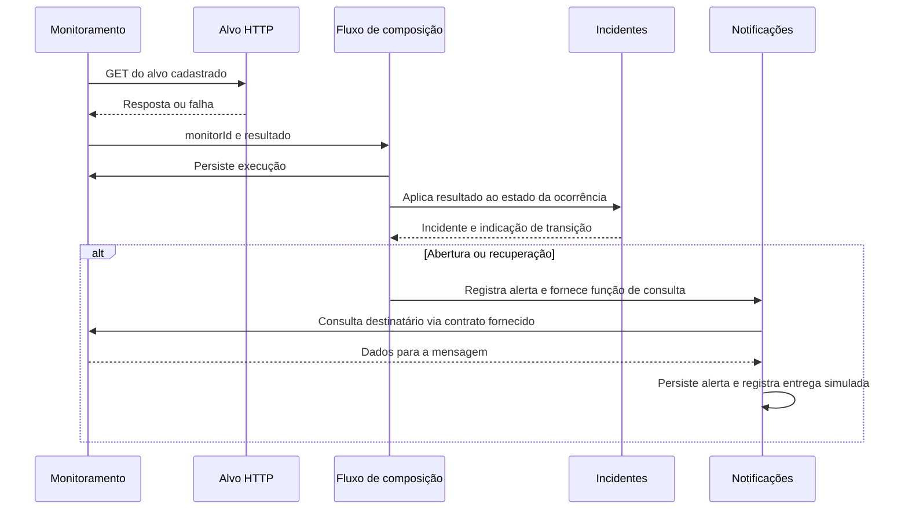

# Serviços e fluxo de monitoramento

O servidor inicia o [scheduler](../src/modules/monitoring/SchedulerService.js) após abrir a porta HTTP. A verificação usa o [PingService](../src/modules/monitoring/PingService.js). Após a requisição, o [fluxo de composição](../src/monitoringWorkflow.js) grava uma execução e chama Incidentes e Notificações por seus pontos públicos.

## Cenário principal

Com as migrations aplicadas, um usuário autenticado cadastra o monitor em `POST /api/monitors`. O scheduler usa os monitores ativos para os quais o minuto da hora é múltiplo do intervalo. Cada resultado persiste código HTTP e latência. Uma falha sem incidente aberto cria a ocorrência. Falhas sucessivas acumulam execuções e reutilizam o mesmo incidente. A recuperação resolve o incidente e grava outro alerta. Os endpoints administrativos permitem consultar as três trilhas de dados.

A persistência da execução precede a avaliação das regras de transição. Se a primeira gravação falhar, o fluxo interrompe o processamento e registra o erro. A operação de alertas captura sua falha e preserva a transição já registrada. Esse comportamento é mantido durante o D2.

## Teste ponta a ponta

[monitoringWorkflow.test.js](../tests/integration/monitoringWorkflow.test.js) usa cadastro e login pela API, PostgreSQL e um servidor de teste local. Ele inicia a composição do scheduler, confere o agendamento a cada minuto e aciona o callback registrado com minutos controlados. O alvo responde `200 → 503 → 503 → 200`. O teste confere a seleção pelo intervalo, quatro execuções, um incidente, dois alertas, recuperação e a rejeição da consulta administrativa para usuário comum.

A suíte [incident.test.js](../tests/integration/incident.test.js) exercita o mesmo fluxo de persistência e alertas com resultados sintéticos, incluindo timeout sem código HTTP. Para execução, use o banco descartável conforme o [README](../README.md).
